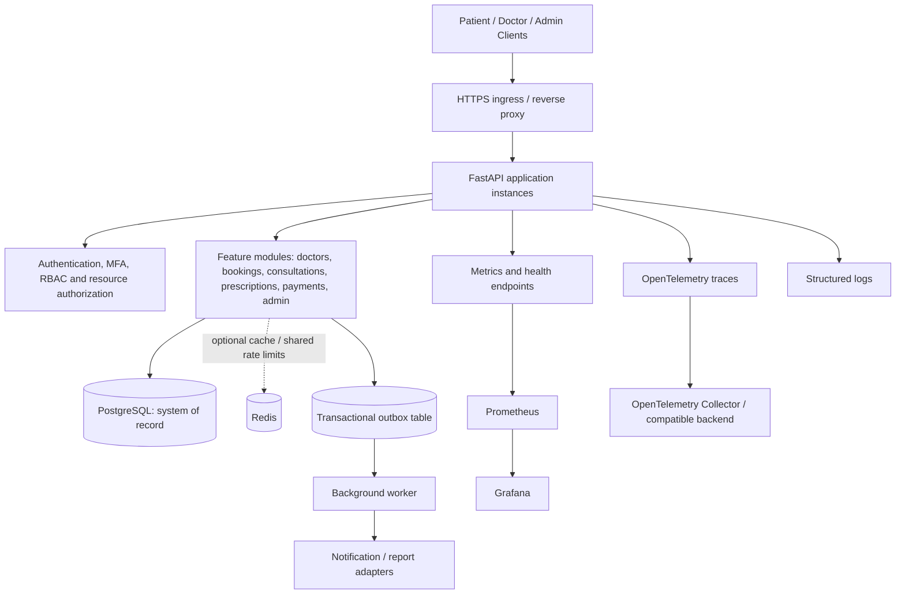
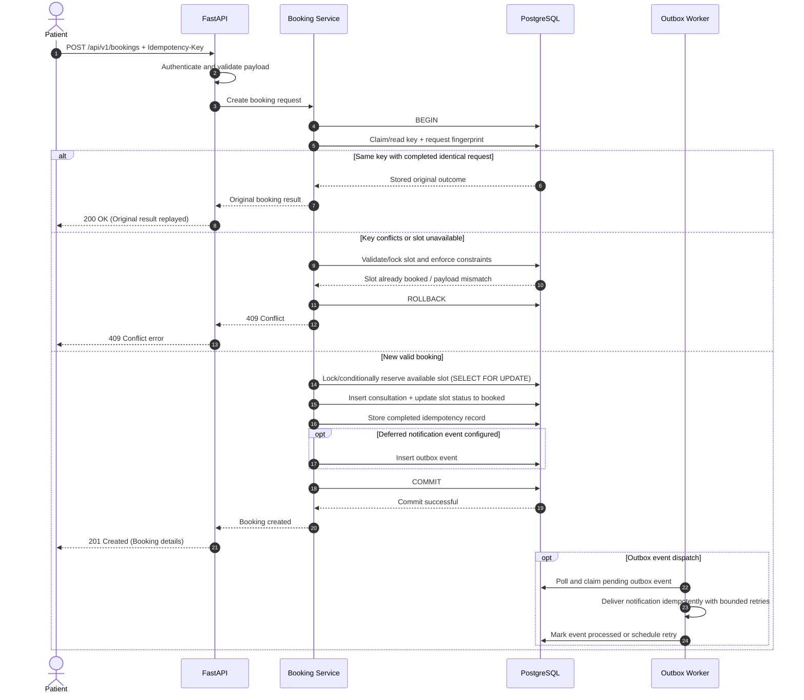

# Amrutam Telemedicine Backend — Architecture

**Status:** Proposed implementation architecture for the take-home assignment  
**Style:** Modular monolith with REST APIs  
**Primary database:** PostgreSQL  
**Primary language:** Python (FastAPI)

## 1. Goals and constraints

The service supports user authentication and roles, doctor search and availability, appointment booking, consultation lifecycle, prescriptions, payment records, audit trails, and administrative analytics. Cross-cutting requirements include security, idempotent writes, observability, automated tests, CI/CD, containerization, retries/backoff, caching/concurrency, transactions/sagas, partitioning strategy, and backup/disaster recovery.

The assignment provides target requirements of 100,000 daily consultations, p95 read latency below 200 ms, p95 write latency below 500 ms, and 99.95% availability. Daily consultations average about 1.16 consultations per second across 24 hours, but this is not API requests per second: a consultation involves multiple reads/writes, and peak traffic can be much higher (e.g. 10x-20x peak-to-average ratio). The implementation must report measured results under a stated load profile; architecture alone does not prove the targets.

## 2. High-level architecture

The initial implementation is a single deployable application with internally separated modules. PostgreSQL is the authoritative source for booking and clinical state. Redis is optional and must never be the authority for slot availability or payment status. A load balancer and multiple stateless API instances are production scaling options, not prerequisites for local development.

### Module boundaries
- **API layer:** route handlers, request/response schemas, authentication dependencies, status codes, pagination, and OpenAPI metadata. Keep business logic out of route handlers.
- **Service layer:** business rules, state transitions, transaction orchestration, authorization rules that depend on resource state, and idempotency handling.
- **Persistence layer:** SQLAlchemy models, repositories/query functions, transactions, constraints, and migrations.
- **Core/security:** settings, password hashing, token issuance/validation, MFA, permission checks, exception mapping, request IDs, rate limiting, and secret handling.
- **Workers:** bounded retryable tasks, outbox polling/dispatch, and deferred notifications or reports.
- **Observability:** request metrics, structured logs, trace instrumentation, health/readiness checks, and dashboards.

Use FastAPI dependency injection for database sessions and authenticated principals. Prefer explicit service dependencies over global mutable state.

## 3. Core data model

Core tables required by the brief are `users`, `profiles`, `doctors`, `availability_slots`, `consultations`, `prescriptions`, `payments`, and `audit_logs`. Supporting tables include `prescription_items`, `idempotency_keys`, and optionally `outbox_events` and notification/job records.

- `users`: UUID ID, normalized unique email, password hash, role, active status, MFA state/encrypted secret as implemented, timestamps.
- `profiles`: one-to-one user relationship and profile fields; avoid collecting unnecessary personal information.
- `doctors`: user relationship, specialization, unique license identifier, verification state, fee/currency, public professional details.
- `availability_slots`: doctor, UTC start/end, status (`available`, `booked`, `blocked` or equivalent), timestamps. Prevent invalid intervals and overlapping availability for the same doctor.
- `consultations`: patient, doctor, slot, status, reason/reference fields, timestamps. Keep valid lifecycle transitions in service logic and, where practical, enforce consistency with database constraints.
- `prescriptions` and `prescription_items`: consultation, issuing doctor, patient, issue/amendment timestamps, medicine instructions. Store the minimum clinically necessary data; do not log prescription contents.
- `payments`: consultation, amount in integer minor units or an exact decimal, ISO currency, status, provider reference and timestamps. Never store raw card data.
- `audit_logs`: actor, action, resource type/ID, timestamp, correlation ID and limited metadata; never store secrets or unnecessary clinical payloads.
- `idempotency_keys`: scope key by actor and operation, store request fingerprint, status, response/resource reference, and expiry. Unique constraint prevents duplicate processing.
- `outbox_events` (if implemented): event type, aggregate/reference ID, payload with minimum necessary fields, creation/dispatch status, attempts and timestamps.

Refer to [docs/diagrams/er-diagram.mmd](diagrams/er-diagram.mmd) for the complete entity-relationship diagram and [docs/data-model.md](data-model.md) for field-level constraints.

Use UUIDs for public identifiers, timezone-aware timestamps normalized to UTC, foreign keys, uniqueness constraints and indexes aligned with actual query patterns. Money must not use binary floating point. Define deletion/retention behavior for clinical and audit records rather than cascading away history accidentally.

## 4. Booking flow, transactions, concurrency and idempotency

**Sequence:** patient sends booking request with an idempotency key → API authenticates and validates → service begins a PostgreSQL transaction → service checks/claims idempotency key → service locks or conditionally updates the requested slot → service verifies that the slot belongs to the specified doctor and remains available and bookable → service creates the consultation and updates slot state → service stores the completed idempotency result and optional outbox event → transaction commits → API returns booking result.

The database must arbitrate simultaneous attempts. Use a row lock such as `SELECT ... FOR UPDATE` or a conditional update, plus constraints preventing more than one active consultation for a slot (partial unique index on `slot_id` where `status NOT IN ('cancelled')`). A preliminary read without a lock/constraint is insufficient. If cancellation releases a slot, the active-booking uniqueness rule and slot state must be updated atomically; historical cancelled consultations should remain available for audit.

For a repeated key with the same actor, operation, and request fingerprint, return the original result when the initial operation completed. Reusing a key with a different payload must return a conflict (`409 Conflict`). Concurrent identical requests must not create duplicate consultations. Store the booking and completed idempotency record in the same transaction when feasible. Handle uniqueness races deliberately instead of turning every integrity error into a generic 500.

Keep transactions short. Do not call a payment provider, send a notification, or perform slow network I/O while holding a database lock. For booking plus deferred notification, write an outbox event within the same local transaction and dispatch it asynchronously.

## 5. Consultation, prescription and payment lifecycles

Consultation states should be explicit and transitions validated (for example `booked → confirmed → in_progress → completed`, with allowed cancellation/no-show paths). Patients must not select arbitrary states. Only the assigned doctor or an appropriately authorized admin can execute the applicable transitions. Prescription creation requires an authenticated, assigned doctor and an eligible consultation. Patients can only read their own prescriptions; doctor access is limited to assigned clinical records. Sensitive admin access must be separately restricted and audited.

Payment records follow a defined state machine such as `pending`, `succeeded`, `failed`, and `refunded` where supported. A mock provider adapter is sufficient to demonstrate the integration boundary in this assignment. Provider calls occur outside database transactions. Use provider idempotency where available, verify webhook signatures, make webhook handling idempotent, and reconcile timeouts/unknown outcomes rather than assuming a timeout means failure. A saga/compensation pattern is relevant only when coordinating a database reservation with an external payment/notification system; a normal PostgreSQL transaction is preferred for local atomic writes.

## 6. Search, caching, partitioning and performance

Index normalized unique email; doctor specialization and verification/filter fields as useful; `(doctor_id, start_at)` for slots; `(patient_id, created_at)` and `(doctor_id, status, created_at)` for consultations; and audit time/action fields according to query patterns. Confirm choices with realistic queries and `EXPLAIN ANALYZE` rather than indexing every column.

Use bounded pagination and deterministic sorting for list/search endpoints. Cache stable public doctor/profile/search results only if measurements justify it. Availability, booking status, payments, permissions, and clinical data are mutable or sensitive; keep PostgreSQL authoritative. Any cache of mutable data needs explicit TTL/invalidation and must never determine whether a booking succeeds.

### Partitioning strategy
At the expected scale of 100,000 consultations/day, time-series tables accumulate data rapidly (~36.5M consultation records/year, ~100M+ audit log entries/year).
- **Threshold for partitioning:** Partitioning becomes necessary when table size exceeds memory cache fit (typically >50M rows or table size >50 GB).
- **Strategy:** Range partitioning by `created_at` (monthly partitions) for `consultations` and `audit_logs`.
- **Considerations:** PostgreSQL requires partition keys to be part of all unique constraints/primary keys. Cross-partition foreign keys and global unique constraints must be evaluated against PostgreSQL 16+ partitioning capabilities. For initial milestones, standard B-tree indexing on `created_at` is implemented first; partitioning migration is documented as an evidence-based operational scale step.

Load tests should separate read and write profiles and report throughput, error rate, p50/p95/p99 latency, connection pool saturation, and database resources. State the expected traffic mix and peak factor. Performance targets must be measured rather than asserted.

## 7. Reliability, retries and background processing

Use timeouts for external HTTP calls and database operations. Retry only transient failures (e.g. connection reset, HTTP 503, deadlock), with a bounded exponential backoff plus jitter and a cap (e.g. base 100ms, factor 2, max 3 attempts). Do not retry validation/authorization errors or a booking conflict. Deadlocks may be retried by rerunning the entire local transaction a small bounded number of times (max 3). For payment timeouts, query/reconcile provider state using a stable operation reference before retrying an external side effect.

Heavy or deferred work (reminders, reporting, notifications) runs in a background worker (`app.worker`). Jobs must be idempotent, have bounded attempts, expose failures, and support a dead-letter/failed-job inspection path. A transactional outbox avoids losing an event between a database commit and queue publish: persist the event in the same local transaction, then dispatch/retry it asynchronously.

### Delivery Semantics & Failure Policy
- **At-least-once delivery:** The transactional outbox guarantees at-least-once delivery. In distributed and multi-process architectures, crashes, network interruptions, or unacknowledged completions may cause re-delivery. Therefore, consumers and handlers are explicitly designed to be idempotent (tracking dispatched actions and skipping duplicate side-effects). **Exactly-once processing cannot be claimed across network boundaries.**
- **Non-blocking concurrency (`SKIP LOCKED`):** Multiple worker instances scale horizontally against the PostgreSQL outbox table using `SELECT ... FOR UPDATE SKIP LOCKED`, claiming non-overlapping batches without lock contention or duplicate execution.
- **Bounded exponential backoff with full jitter:** Retries are scheduled with exponential backoff (`delay = min(max_delay, base_delay * 2^(attempt - 1)) * jitter`), preventing thundering herds against downstream services.
- **Failure classification & Dead-Letter queue:** Transient errors (network drops, connection timeouts, database serialization conflicts) are retried up to `max_attempts` (default 5). Non-retryable errors (schema bugs, invalid payloads) and exhausted attempts transition directly to `dead_letter` status with the full exception trace recorded in `last_error`.
- **Payload privacy:** Outbox event payloads contain only minimal resource identifiers (`consultation_id`, `patient_id`, `doctor_id`, `slot_id`, `amount_minor`). Clinical notes, appointment reasons, diagnosis details, prescription items, and card details are never included.

### Rate Limiting & Resilience Policies (Milestone 20)
- **Sliding Window Rate Limiting:** Configurable rate limiting enforced via FastAPI route dependencies (`app.core.rate_limit.RateLimiter`). Sensitive endpoints are guarded under dedicated buckets:
  - Auth/MFA (`/api/v1/auth/register`, `/api/v1/auth/login`, etc.): Default 10 requests / 60 seconds.
  - Sensitive Writes (`/api/v1/bookings`, `/api/v1/payments/*`, cancellations, slot mutations, prescriptions): Default 30 requests / 60 seconds.
  - Client Identification: Authenticated requests are scoped to `user:{user_id}`; anonymous requests are scoped to `ip:{client_ip}` (derived from trusted proxy headers or client host).
  - Rate Limit Headers & Responses: Allowed requests receive standard headers (`X-RateLimit-Limit`, `X-RateLimit-Remaining`, `X-RateLimit-Reset`). Exceeded limits return HTTP 429 Too Many Requests with a `Retry-After: <seconds>` header and standardized `ErrorResponse(code="RATE_LIMIT_EXCEEDED")`.
- **Redis vs In-Memory Storage & Local-Only Limitation:**
  - `InMemoryRateLimiter`: Thread-safe and reentrant sliding window log maintained in process memory.
  - **Local-Only Limitation Notice:** In-memory counters are local to each operating system process. When running multiple replica containers or multi-worker processes behind a load balancer without sticky sessions, counters are not shared across processes, allowing aggregate traffic to scale with the replica count.
  - `RedisRateLimiter`: Uses atomic Redis Sorted Sets (ZSET) pipelines (`ZREMRANGEBYSCORE`, `ZCARD`, `ZRANGE`, `ZADD`, `EXPIRE`) to enforce shared quotas across any number of stateless API replicas. If Redis becomes temporarily unreachable, the adapter fails open to the in-memory fallback to avoid dropping user requests.
- **Request Body & Pagination Limits:**
  - `RequestBodyLimitMiddleware`: Rejects request payloads exceeding `settings.max_request_body_bytes` (default 1 MB) with HTTP 413 Payload Too Large (`code="PAYLOAD_TOO_LARGE"`). Checks `Content-Length` headers immediately and streams chunked payloads up to the byte ceiling without buffering unbounded requests into memory.
  - Standardized Pagination (`app.core.pagination`): Bounded query parameters (`page >= 1`, `1 <= page_size <= 100`). Requests exceeding 100 items per page are rejected with HTTP 422 (`VALIDATION_ERROR`).
- **External HTTP Call Timeouts & Bounded Retries (`app.core.http_client`):**
  - All outbound HTTP interactions use explicit bounded timeouts (`connect=3.0s`, `read=5.0s`, `write=5.0s`, `pool=3.0s`) preventing socket leakage and thread exhaustion.
  - `execute_http_request_with_retry`: Bounded retries with jittered exponential backoff exclusively for transient conditions (connect timeouts, network drops, HTTP 502/503/504). HTTP 4xx client errors (400, 401, 403, 404, 409, 422) are permanent and are never retried.
- **Database Deadlock Transaction Retries (`app.core.retry`):**
  - Strict classification rules:
    - **Deadlocks:** PostgreSQL SQLSTATE `40P01` (`deadlock_detected`) and `40001` (`serialization_failure`) are classified as transient conflicts.
    - **Non-retryable conditions:** Validation errors (`BadRequestError`), authorization/permission errors (`ForbiddenError`, `UnauthorizedError`), and booking slot conflicts (`ConflictError` e.g. `SLOT_NOT_AVAILABLE`, `uq_consultations_active_slot`) **MUST NEVER BE RETRIED**.
  - `execute_transaction_with_deadlock_retry`: Safely reruns the entire transaction from the beginning up to `db_deadlock_max_retries` (default 3) attempts. Rolls back the session before each retry attempt and applies decorrelated jitter delay. If attempts exhaust, raises `DeadlockRetryExhaustedError` (HTTP 503) with zero database credentials or internal SQL strings exposed in error messages.

## 8. Security and privacy

Use Argon2 password hashing, short-lived signed access tokens, strict token validation, TOTP MFA for doctor/admin accounts, rate limits, generic authentication errors, and safe token/secret rotation practices. Enforce both role and resource ownership/assignment at the service/query layer. Apply Pydantic validation, parameterized ORM queries, least-privilege database roles, TLS in deployment, encryption at rest for database/disks/backups, and environment/managed-secret injection. Protect MFA secrets with encryption key material sourced from environment/secret management; never log or return it.

Treat health information, prescriptions, credentials, MFA secrets and payment references as sensitive. Do not log request bodies by default. Audit sensitive state changes and selected sensitive reads where appropriate. Restrict audit log access and document retention. Add dependency scanning and secret scanning to CI, and describe how key rotation and compromised credential response would work. This design is not a certification of compliance with any healthcare or privacy law; legal requirements depend on jurisdiction and deployment context.

## 9. Observability and operations

Emit JSON logs with timestamp, level, service/environment, request/correlation ID, route template, status, duration, and safe error metadata. Provide request count/error/latency histograms, DB pool/query metrics, booking success/conflict counts, idempotency replay counts, worker queue/failure metrics, and payment outcome counts with low-cardinality labels. Do not label metrics with user IDs, emails, booking IDs, or other high-cardinality/private values.

Instrument FastAPI, database spans, and outbound HTTP calls with OpenTelemetry where feasible. Provide a dashboard for request rate, error rate, p95/p99 latency, DB pool pressure, booking outcomes and worker failures. Liveness means the process is running; readiness means the instance can currently serve traffic. Redact sensitive attributes from traces and logs.

## 10. Deployment, backup and disaster recovery

Local development uses Docker Compose with PostgreSQL and optional Redis/worker/monitoring components. CI must lint, test, validate migrations, run relevant integration tests against PostgreSQL, scan dependencies/secrets, and build the container. A production deployment should use HTTPS ingress, multiple stateless instances, managed secrets, least-privilege identities, monitored databases, restricted network access, and a safe migration/rollback procedure.

Document encrypted backups, backup frequency, retention, point-in-time recovery if supported, and regular restore drills. Set explicit proposed RPO/RTO values and explain how they would be validated; do not present them as achieved unless tested. Disaster recovery covers restoring data and service configuration, rotating credentials if needed, and verifying booking/clinical data integrity after recovery. Availability of 99.95% requires operational controls and evidence beyond code in this repository.

## 11. Architecture decisions and trade-offs

1. **Modular monolith over microservices:** lower operational complexity in a 4–5 day take-home; module boundaries allow future decomposition without premature distributed-system overhead.
2. **PostgreSQL as system of record:** transactions, constraints, row locks and relational integrity support booking correctness.
3. **Redis optional:** use only where caching/shared rate limiting/queue needs justify added operations; never trust it as final booking truth.
4. **REST/OpenAPI:** clear interoperable contract and easy evaluator inspection.
5. **Mock payment adapter:** shows safe boundaries and idempotency without making real charges or storing card data.
6. **Outbox for critical deferred events:** reliability improves at a modest implementation cost; if omitted, document that the first version's queue publish is not transactionally guaranteed.

## 12. Validation and acceptance

The repository should contain API schemas, migrations, tests, an automated CI workflow, Docker setup, the security checklist and threat model, observability configuration/instructions, a README and a five-minute demo. Demonstrate at least one valid booking, a duplicate idempotent retry, a concurrent booking conflict, an unauthorized resource access rejection, lifecycle transitions, and metrics/log visibility. Report exactly what is implemented, what is mocked, measured test results, and known limitations.

## 13. Performance, scaling, and partitioning rationale

This section details the performance architecture, distinguishing currently implemented optimizations from future production scaling strategies.

### 13.1 Implemented Optimizations

The current monolithic implementation applies database-level and application-level tuning to ensure predictable performance under concurrent load:

1. **Targeted Database Indexes & Constraints:**
   - `ix_availability_slots_doctor_start_status (doctor_id, start_at, status)`: Covers the primary slot discovery query, satisfying equality on doctor/status and range filtering on start time in a single index lookup.
   - `uq_consultations_active_slot`: A partial unique index on `consultations(slot_id) WHERE status NOT IN ('cancelled')` prevents double-booking at the relational engine level without requiring table-wide lock escalation.
   - `ix_doctors_specialization` & `ix_doctors_user_id`: Accelerates directory search filtering and relational joins without sequential scans.
   - `ix_idempotency_keys_client_key`: Composite index on `(client_id, key)` providing fast O(1) lookups for deduplicating concurrent/retried mutation requests.
   - `ix_outbox_events_status_attempts_created`: Enables the background outbox publisher to efficiently fetch pending messages in chronological order.

2. **Connection Pooling & Concurrency Controls:**
   - Asynchronous SQLAlchemy / asyncpg connection pool with bounded limits (`pool_size=10`, `max_overflow=20`, `pool_timeout=30.0s`), preventing database socket starvation under traffic spikes.
   - Fine-grained row locking (`SELECT ... FOR UPDATE`) on individual `availability_slots` rows ensures atomic reservation without contention spreading to unaffected slots or doctors.

3. **Memory Safeguards & Bounded Streaming:**
   - `RequestBodyLimitMiddleware` rejects oversized payloads (> 1 MB by default) with HTTP 413, streaming chunked payloads up to the limit without buffering unbounded bodies into RAM.
   - Strict pagination bounds (`page >= 1`, `1 <= page_size <= 100`) across all list endpoints prevent accidental full-table memory heap dumps.

4. **Low-Cardinality Observability:**
   - Prometheus metrics use parameterized route templates (e.g. `/api/v1/doctors/{id}/slots`) and coarse status codes rather than raw request URLs, preventing high-cardinality metric explosion.

### 13.2 Future Production Scaling Roadmap

For higher traffic scale exceeding single-node vertical capacity, the architecture supports the following incremental scaling paths without breaking the modular domain model:

1. **Read-Write Splitting (Read Replicas):**
   - The workload mix is predominantly read-heavy (70–80% search and slot browsing vs 10–20% booking/payment writes).
   - In production, configure read-only database connections pointing to PostgreSQL streaming read replicas for doctor directory queries and slot lookups. Primary PostgreSQL retains exclusive responsibility for write transactions, row locks, and the transactional outbox table.

2. **Horizontal Table Partitioning:**
   - **`consultations` Table:** High-growth clinical appointment records can be horizontally range-partitioned by `created_at` (e.g. monthly or quarterly partitions using PostgreSQL native declarative partitioning or `pg_partman`). Active OLTP queries target current partitions, while historical records reside in older partitions, keeping active B-tree index working sets entirely in RAM.
   - **`audit_logs` Table:** Immutable append-only audit logs can be partitioned by month. Older partitions can be detached and archived to low-cost cold storage (e.g., S3 / Cloud Storage Glacier tiers) to meet regulatory retention requirements without inflating transactional storage costs.
   - **`outbox_events` Table:** As message volume grows, implement scheduled vacuuming or range partitioning by creation date, or prune processed events older than 7–14 days.

3. **Distributed Caching (Redis Cache-Aside):**
   - Doctor profiles, specializations, and verified credentials change infrequently and are prime candidates for Redis cache-aside with short TTLs (e.g. 5–15 minutes) and event-driven invalidation.
   - *Design Boundary:* Availability slots and active booking transactions must continue to read directly from PostgreSQL with row-level locks; slot availability should never rely on cached data as the source of truth to avoid race conditions.

4. **Stateless Horizontal Replica Scaling:**
   - The FastAPI backend application is stateless. Additional worker processes or container instances can be horizontally scaled behind an Application Load Balancer / Kubernetes Ingress Controller with Horizontal Pod Autoscaler (HPA) policies based on CPU and request latency.
   - Distributed rate limiting via `RedisRateLimiter` ensures client quotas remain uniformly enforced across all distributed API replicas.
